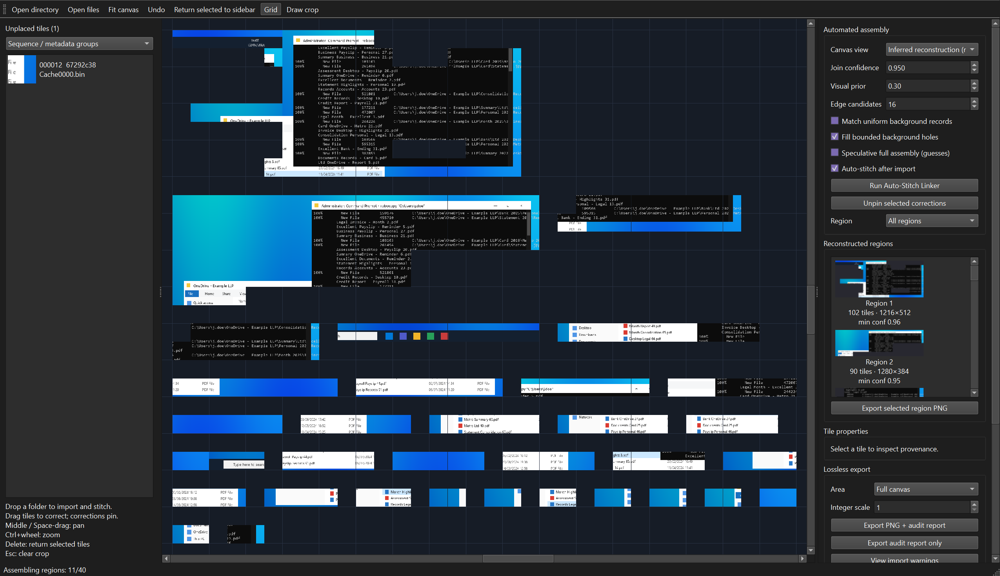
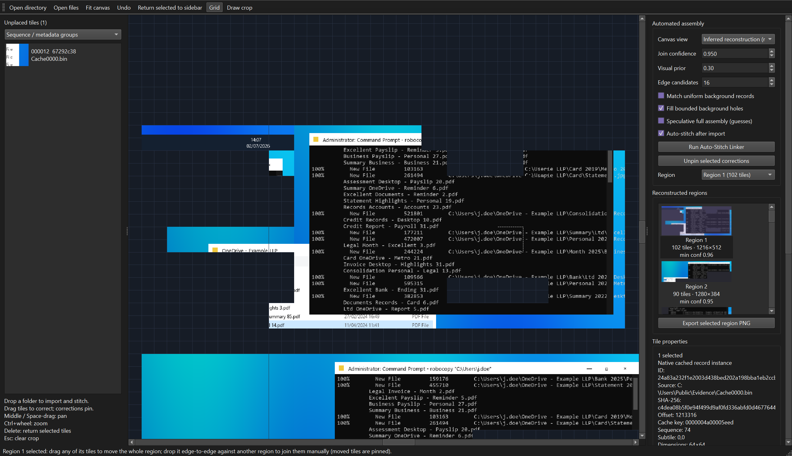
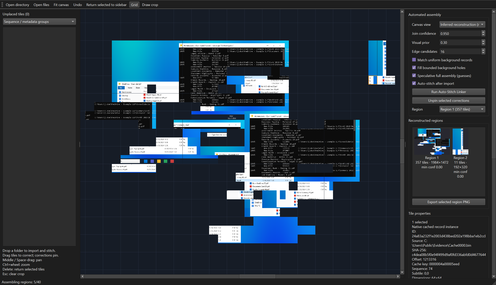

# Puzzle Pieces — RDP Bitmap Cache Stitcher

Python 3.11+ / PyQt6 desktop application for automatic RDP bitmap cache reconstruction. Drop a directory or `.bin` / `.bmc` file onto the canvas. The application decodes, hashes, filters, deduplicates and attempts a conservative assembly automatically. Unsupported or ambiguous material remains available for review.

**[Download the Windows build](../../releases/latest)** — a single `.exe`, no install or Python required.

## Screenshots

All screenshots below are rendered from the bundled synthetic test fixture (`synthetic.py`), not real case data.

**Inferred reconstruction** — joined regions from a synthetic RDP8 cache, each one a cluster of native cached records the engine is confident about:



**A reconstructed region with its evidence** — clicking a tile shows its provenance and the seam evidence that joined it:



**Speculative full assembly** — after confident joins run out, it keeps joining the best remaining fits to build the largest image it can; guessed tiles are outlined in orange:



## Run

Windows PowerShell:

```powershell
py -3.11 -m venv .venv
.\.venv\Scripts\python.exe -m pip install -r requirements.txt
.\.venv\Scripts\python.exe gui.py
```

Linux / macOS:

```bash
python3 -m venv .venv
.venv/bin/python -m pip install -r requirements.txt
.venv/bin/python gui.py
```

Open a path immediately:

```bash
python gui.py /path/to/cache-or-tiles --audit-dir /path/to/case/audit
```

Headless batch processing:

```bash
python cli.py /path/to/cache-or-tiles -o /path/to/case/output
python cli.py /path/to/cache-or-tiles -o output --confidence 0.97 --min-region 3 --native
```

The CLI exports one PNG per inferred region (`<label>.regions/`), an all-regions sheet, optionally the native bitmaps (`--native`, labelled as not a reconstruction), a forensic JSON report and a JSONL audit trail. If no joins pass, it writes the report without inventing an arrangement. Exit codes: `0` valid tiles processed, `2` no usable tiles, `1` processing/export error, `130` keyboard interruption. Review warnings even when processing succeeds.

## Supported inputs

| Input | Handling |
| --- | --- |
| Loose BMP files | Pillow validates BMP data; supports 1–256 pixels per dimension, including bmc-tools 64-pixel tiles. |
| `Cache*.bin` with `RDP8bmp\0` signature | Header versions 1 and 6; 12-byte bitmap records; top-down BGRX pixel data. Version 6 validated against public cache samples. |
| `bcache2.bmc` | Fixed 64×64 byte slots with 20-byte headers; 8-bit indexed colour and a retained legacy palette. |
| `bcache22.bmc` | Fixed slots; RGB565 raw pixels and bounded interleaved RLE. |
| `bcache23.bmc` / `bcache24.bmc` | Fixed slots; 24-bit BGR / 32-bit BGRX pixels; interleaved cache records where present. |
| Renamed `.bmc` files | Infers slot depth from raw record length or a unique valid next-record boundary. Ambiguous depth produces a warning. |

Preserve original BMC filenames, particularly if the first slot is compressed. Unknown BIN versions, truncated slots, invalid dimensions and unsupported compression orders are logged. Earlier valid records from a malformed file remain usable. Empty files are reported. This is a structured cache parser; it does not carve arbitrary binary streams, decode network PDUs or interpret RDP 6.0 planar compression as interleaved RLE. Unused bytes in BMC slots are not treated as active tiles.

Native bitmaps are split into 32×32 subtiles without resizing. Partial right/bottom subtiles preserve their true dimensions and appear in the sidebar for manual placement. Known full-subtile adjacencies are retained as native bitmap geometry rather than guessed from borders. Normalized pixels are top-down RGB. Alpha/X bytes are discarded, with provenance retained for the original source.

## Automation

1. Recursive discovery and bounded file I/O workers read sources without modifying them. Source MD5 and SHA-256, file
   size and mtime are recorded. A detected source change during reading discards that file's results.
2. Decoded pixels are split into 32×32 subtiles and deduplicated by SHA-256 **for storage and search only**. Uniform
   tiles seen at least three times are flagged as backgrounds.
3. **Native records are the unit of reconstruction.** Every record occurrence is rebuilt from its subtiles (including
   flagged backgrounds), so a record's pixels are never split and identical pixels stored in two records remain two
   instances with their own source offset, sequence and cache key.
4. **Seam model calibrated on the evidence.** Each record is cut at three positions per axis; those genuine internal
   seams are the positives. Pieces of other records with the same background colour are the negatives (the hard case:
   text on a shared terminal or window background). Features are boundary continuity relative to each side's internal
   gradient, a stricter prediction-based continuity, edge texture, background agreement and text-line (ink-row/column)
   alignment in an 8-pixel band. Flat edges are not rejected; smooth or blank edges simply carry less evidence. The
   model yields a log-likelihood ratio (LLR) per seam and reports its own TPR/FPR.
5. **Cache-order structure measured, not assumed.** Within each cache file (or sidecar group), an EM mixture estimates
   how often record *k+d* is the right or lower neighbour of record *k*, with offsets competing for the same evidence.
   On the supplied real cache, record *k−1* was the right-hand neighbour about 44% of the time and *k+1* about 13%.
   Offsets below 2% are ignored. Explicitly different sidecar groups never share a chain.
6. **Assembly by posterior, not greedy best match.** A merge of two blocks is scored with the prior (measured
   cache-order rate, else a visual prior spread over all records), the combined LLR of *every* seam the merge would
   create, and every competing proposal for the same tile edge or for the same block pair at another offset. Positive
   evidence beyond four seams is tempered because adjacent seams are correlated; one seam with LLR ≤ −4 vetoes the merge.
   Merges above the **Join confidence** (default 0.95) are applied, highest first, in rounds.
7. **Background fills.** A uniform cached tile may fill an interior hole bounded by matching neighbours on opposite
   sides when exactly one colour fits. Each fill is a new, labelled instance of that cached record.
8. Regions (two or more records) are packed side by side. Their relative placement, screen coordinates and capture time
   are unknown. Records without a confident join stay in **Unplaced tiles** for review.

Confidences are model posteriors from a heuristic (naive-Bayes) seam model. They are not validated error rates.

### What to expect on real caches

Pixel evidence alone cannot place most dense terminal text: seams usually fall between character cells, and many tiles
share the same background and line pitch. In the supplied cache, a typical terminal tile edge had a median of 14
alternative partners with strong-looking seams. Those records are joined only when cache order supports the join, and
vertical joins between text rows are rare. Expect readable horizontal runs, title bars, toolbars and UI fragments rather
than whole desktops. Smooth wallpaper gradients are weak evidence. Accuracy falls when caches are partly evicted, and
mixing many caches adds rivals and lowers recall.

## Metadata

An optional `tile_metadata.json` in each input directory can supply independently established capture times or grouping:

```json
{
  "tile0001.bmp": {"timestamp": "2026-10-01T12:58:47Z", "group": "session-A"},
  "tile0002.bmp": {"timestamp": "2026-10-01T12:58:48Z", "group": "session-A"},
  "Cache0000.bin": {"group": "host-A-user-X"}
}
```

Timestamp values may also be Unix seconds. ISO timestamps must include a timezone. Directory sidecars use exact input basenames. A timestamp for a cache file applies to all its records; it does not add per-record timing. Sidecar content is an analyst-supplied hint. Malformed entries generate warnings.

Cache record/file numbering and source modification time are ordering hints, not proven capture chronology; cache order is used only to the extent its adjacency rate is measured on the evidence. Regions are inferred areas, not proven RDP sessions, windows or screen states. Deduplication no longer removes spatial instances: every record occurrence is retained, and uniform background tiles may be re-used as labelled fills.

## Workspace

| Action | Control |
| --- | --- |
| Import folder / files | Toolbar or drop onto canvas; each import replaces the current workspace. |
| Pan | Middle-drag or Space + left-drag; scrollbars also work. |
| Zoom | Ctrl + wheel, anchored under pointer. |
| Fit placed tiles | `F` or toolbar. |
| Select multiple tiles | Drag a selection rectangle or use Qt selection modifiers. |
| Move / correct | Drag tile(s); positions snap to 32-pixel cells. Occupied cells are rejected. |
| Place an unplaced tile | Drag from sidebar or double-click to place near the view centre. |
| Pin manual corrections | Moving/placing pins the tile automatically. Reruns preserve pinned coordinates. |
| Release a pin | Select tile(s), then **Unpin selected corrections**. |
| Return to sidebar | Select tile(s), then `Delete`. |
| Undo manual edit | `Ctrl+Z`; individual tile changes are undone one at a time. |
| Draw export crop | Enable **Draw crop**, then drag; `Esc` clears the rectangle. |
| Toggle grid | Toolbar checkbox. |
| Focus a region | Click its preview under **Reconstructed regions**, or choose it under **Region**. |
| Export one region | Select its preview, then **Export selected region PNG**. |

Pinned tiles are excluded from fresh automatic linking; inferred blocks are packed to their right. The engine does not attempt to infer new neighbours around a pinned correction. Multi-tile movement updates all selected placements. Automatic reassembly clears the manual undo history.

## Export and audit

Export the full canvas, drawn crop, selected tiles, the current region or every region separately. Output is RGBA PNG with transparent holes; the grid, selection outlines and UI overlays are excluded. Native export scale is `1`. Integer scales `2–8` use nearest-neighbour replication, preserving pixel colours. Crops use canvas pixels. Exports above 100 million pixels use scanline streaming to avoid whole-canvas allocation. The upper safety limit is one billion pixels and 250,000 pixels per dimension. Use the contact sheet or a crop for extreme layouts.

Each PNG receives a SHA-256 and a companion JSON report containing source hashes, dimensions, subtiles, record offsets, cache keys, duplicate occurrences, filtering decisions, placements, links, settings, warnings and audit events. PNG writes use a temporary file and atomic replacement. The companion report is also atomic, but PNG/report pairs are not one cross-file transaction. Already written PNGs and their audit events remain if a multi-block export later fails or is cancelled.

Audit events are appended automatically under `~/RDP-Stitcher-Audits` unless `--audit-dir` is supplied. They include tile coordinates and scores, manual overrides, source hashes, assembly settings and exports. A SHA-256 hash chain detects event alteration or interior deletion. It is not a digital signature or protection against complete chain rewriting/trailing truncation; preserve a separately trusted copy/hash for evidential use.

Verify an audit file:

```bash
python -c "from audit import verify_audit; print(verify_audit('case.audit.jsonl'))"
```

All import, decoding and matching jobs run in spawned processes supervised by QThreads to isolate Python's GIL from the GUI. Individual files inside ingestion use a bounded thread pool. Cancellation is cooperative. PNG/report export runs in a background QThread. The GUI builds or updates graphics items in approximately 6 ms slices; sidebar and block selectors use Qt models. Pan/zoom remain available during processing, while edits/export are disabled to protect the workspace snapshot. Source scan, hash, record and assembly boundaries provide cancellation checkpoints. A single image encode or native query may finish before cancellation takes effect.

## Verification and performance

```bash
python -m pip install -r requirements-dev.txt
python -m pytest -q tests
python evaluate.py --out evaluation          # correct/false joins on synthetic ground truth
python benchmark.py --screens 6 --gui --output benchmark-results.json
```

For a headless Linux test environment, set `QT_QPA_PLATFORM=offscreen`. A normal desktop installation does not need that variable. Qt's Linux platform plugin may require the distribution's XCB libraries when running with a visible display.

Tests exercise parsing, record rebuilding with duplicate subtiles, realistic synthetic screens with known adjacency
(wallpaper, taskbar, Explorer, dense console text, a scrolled/moved second state, cache hits and evicted records),
shuffled terminal text without cache order, background fills, pins, cancellation, multi-tile movement, region previews,
pixel-exact PNG/crop/streamed exports and audit tamper detection. `evaluate.py` reports precision (correct / all
output adjacencies), recall (distinct true adjacencies between non-uniform stored tiles that are recovered) and coherent
regions (≥4 tiles, no false join). Synthetic results measure those fixtures, not arbitrary desktops. Qt heartbeat
measurements indicate event-loop latency, not rendered FPS; continuous 60fps is not guaranteed.

Public BIN validation used BriMor Labs' [Test-Cache-Files.zip](https://github.com/brimorlabs/rdpieces): 60,808 raw subtiles across three version 6 caches, 17,124 unique representatives, 43,684 duplicates, 500 suppressed backgrounds and no parsing warnings. The first 100 decoded native bitmaps were compared byte-for-byte with ANSSI bmc-tools output. Public fixture data is not redistributed in this package. BMC validation uses generated fixtures for every supported depth and compressed records; additional case samples should be validated before case-specific evidential use.

## Modules

| Module | Responsibility |
| --- | --- |
| `parser.py` | Cache/BMP ingestion, bounded RLE, pixel conversion, hashes, sidecars, filtering and deduplication. |
| `engine.py` | Record rebuilding, calibrated seam model, cache-order EM priors, posterior block merging, background fills, region packing. |
| `synthetic.py` | Realistic synthetic screens and RDP8 caches with ground truth. |
| `evaluate.py` | Correct/false join and region metrics against synthetic ground truth. |
| `layouts.py` | Contact sheet and native-bitmap views (not reconstructions). |
| `gui.py` | PyQt6 scene, lazy thumbnails, region previews, manual corrections and export controls. |
| `models.py` | Shared immutable provenance/placement records and typed results. |
| `jobs.py` | Portable spawned-process supervision, progress and cancellation. |
| `exporter.py` | Lossless PNG rendering, crops, hashes and forensic manifest. |
| `audit.py` | Persistent hash-chained JSONL audit records. |
| `cli.py` | Headless case processing and exports. |
| `benchmark.py` | Multi-screen synthetic accuracy/runtime workload and Qt heartbeat measurements. |

## Format references and licensing

Cache container layout and the retained legacy palette are based on [ANSSI bmc-tools](https://github.com/ANSSI-FR/bmc-tools), distributed under CeCILL 2.1. The interleaved RLE implementation is bounded and implemented for this application using [Microsoft's protocol description](https://learn.microsoft.com/en-us/openspecs/windows_protocols/ms-rdpbcgr/b6a3f5c2-0804-4c10-9d25-a321720fd23e). UI/search references: [Qt Graphics View](https://doc.qt.io/qt-6/qgraphicsview.html), [SciPy cKDTree](https://docs.scipy.org/doc/scipy/reference/generated/scipy.spatial.cKDTree.query.html).

This source distribution is supplied under CeCILL 2.1; see `LICENSE.txt` and `NOTICE.txt`. PyQt6 has its own GPL/commercial licensing terms, and dependencies retain their respective licences. Check dependency obligations before distributing a bundled executable. No external extraction program, model download or runtime network connection is required.
